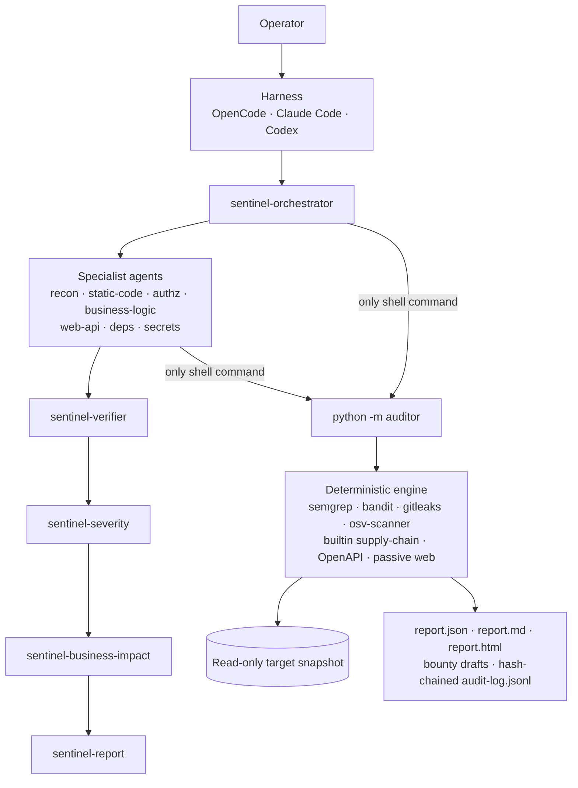

# Sentinel Auditor

**A read-only, evidence-driven, multi-agent security auditor for authorized source code, repositories, API specs, configs, and passively observed websites.**

[](https://www.python.org/)
[](#testing)
[](LICENSE)
[](#safety-model)
[](#the-agent-team)

Sentinel Auditor pairs a **deterministic scanning engine** that works with zero model calls with a
team of specialist AI agents that add the reasoning findings pattern tools miss — authorization
flaws, business-logic bugs, cross-file data flow, and false-positive triage. One canonical agent
roster is rendered for **OpenCode** (primary), **Claude Code**, and **Codex**; any harness that
reads `AGENTS.md` + Agent Skills can drive it too.

> [!IMPORTANT]
> **Authorization is your responsibility.** Use Sentinel only on systems you own or have explicit
> written permission to assess. The tool never exploits, never runs target code, never sends
> state-changing requests, and never submits a bug bounty report. An unconfirmed scope means
> offline analysis only.

## Why Sentinel Auditor

- **Controls don't depend on the model.** Read-only behaviour is enforced by a central policy,
  per-agent least-privilege harness permissions, a universal pre-tool hook, a scope-gated CLI as
  the only shell surface, immutable target snapshots, an SSRF-hardened GET/HEAD-only network
  guard, and optional container isolation. **155 automated tests** verify these without an LLM.
- **Evidence or it didn't happen.** Every agent finding's code excerpt is checked against the
  immutable snapshot. Invented files are rejected; invented excerpts are demoted to
  `unverified_hypothesis`. Agents cannot confirm their own findings, and "the models agree" is
  explicitly rejected as evidence.
- **Deterministic baseline first.** `python -m auditor run <scope>` produces a complete report
  with **zero model calls** (semgrep, bandit, gitleaks, osv-scanner, builtin supply-chain,
  OpenAPI and passive-web checks). Agents layer reasoning findings on top — they are never the
  only source of truth.
- **Business impact is separate from technical severity.** A dedicated agent judges how much each
  verified finding matters to *this* organization — asset tier, data at risk, production and
  internet exposure, the program's own severity table — as a **P1–P5 business priority** with a
  submission recommendation. Business context comes only from the protected scope file and can
  never inflate technical severity.
- **Honest scoring.** Risk zone, severity, confidence, verification status, business priority and
  financial exposure are separate dimensions. Critical requires a CVSS vector; header-only issues
  are capped low; `GREEN` never means "secure"; uncovered components are `NOT_ASSESSED`.
- **Bug-bounty ready.** Reports include a per-finding submission assessment and a draft under
  `bounty/<id>.md` — with safe reproduction notes, missing evidence, and explicit "no eligibility
  claim / no reward estimate".

## How it works



The models are interchangeable reasoning engines — **not** a security boundary. Everything that
must be true for safety is enforced below the model. See
[docs/ARCHITECTURE.md](docs/ARCHITECTURE.md) and [docs/THREAT_MODEL.md](docs/THREAT_MODEL.md).

## Quick start

**Requirements:** Python 3.11+ and at least one supported harness. The external scanners are
optional but recommended.

```bash
git clone https://github.com/sufianweb3/security-team.git
cd security-team

python -m venv .venv
# macOS/Linux:
source .venv/bin/activate
# Windows PowerShell:
# .venv\Scripts\Activate.ps1

pip install -r requirements-dev.txt
python scripts/install_tools.py        # optional: pinned + SHA-256-verified scanners
python scripts/setup.py --check
python -m pytest
```

Render the harness configuration for the harness you use:

```bash
python scripts/setup.py --harness opencode --profile deepseek
# or: --harness claude | codex | all
# profiles: deepseek | anthropic | openai | inherit
```

### Smoke test — no LLM required

```bash
python -m auditor run config/scopes/vulnapp-local.yaml
```

This audits the bundled intentionally vulnerable training fixture and writes
`audit-output/vulnapp-local/<run>/report.{json,md,html}`. Compare the result with the committed
example in [`examples/vulnapp-audit/`](examples/vulnapp-audit/). The fixture is never executed.

### Run an agent-driven assessment

1. Copy a scope template from [`config/scopes/`](config/scopes/) and fill it in.
2. Keep `authorization.status: unconfirmed` until **you** have confirmed you are authorized.
   Unconfirmed scopes are analyzed offline only.
3. Start the orchestrator:
   - **OpenCode:** `opencode` → press <kbd>Tab</kbd> → select `sentinel-orchestrator`.
   - **Claude Code:** `claude --agent sentinel-orchestrator` (accept the workspace-trust prompt
     so the `PreToolUse` hook runs).
   - **Codex:** trust the project, approve the hook in `/hooks`, then use the
     `$sentinel-run-audit` skill.
4. Ask: *"Run the sentinel-run-audit skill on `config/scopes/<your-scope>.yaml`."*

Optional but recommended for bug bounty work: fill in the scope's `business_context` (asset tiers,
data classes, environment, internet exposure, program severity table). Without it, findings are
ranked by technical severity only and business priority reads **not assessed**.

## What you get

Each run writes to `audit-output/<assessment>/<run>/`:

| Output | Contents |
|---|---|
| `report.json` | Schema-valid machine report with findings, evidence, coverage and limitations |
| `report.md` | Human-readable report optimized for triage and bug bounty review |
| `report.html` | Self-contained, CSP-locked HTML report |
| `bounty/<id>.md` | Per-finding draft with safe reproduction outline and missing-evidence notes |
| `findings.json` | Full ledger, including rejected candidates and why they were rejected |
| `audit-log.jsonl` | Append-only, hash-chained, redacted audit log |
| `inventory/` | Languages, frameworks, manifests, specs, entry points and "not inspected" list |
| `work/` | Raw scanner output, retained for verification |

## The agent team

| Agent | Tier | Responsibility |
|---|---|---|
| `sentinel-orchestrator` | strong | Validates scope, ingests inputs, runs the baseline and dispatches specialists |
| `sentinel-recon` | cheap | Passive inventory and attack-surface map; records what could not be inspected |
| `sentinel-static-code` | strong | Injection, deserialization, path traversal, SSRF sinks, unsafe file handling, crypto misuse |
| `sentinel-web-api` | cheap | API specs, configs and recorded HTTP observations: auth assumptions, headers, CORS, cookies, TLS |
| `sentinel-deps` | cheap | Vulnerable versions, risky lifecycle scripts, unpinned CI actions, unverified downloads |
| `sentinel-secrets` | cheap | Secret-detection triage in context |
| `sentinel-authz` | strong | Authentication, session and access control: missing checks, IDOR, tenant isolation, privilege boundaries |
| `sentinel-business-logic` | strong | Quota/coupon abuse, state-machine and approval gaps, transaction ordering, smart-contract logic |
| `sentinel-verifier` | strong | Independent review of other agents' candidates; the only agent that can confirm |
| `sentinel-severity` | strong | CVSS v3.1 scoring, severity normalization, financial exposure validation |
| `sentinel-business-impact` | strong | P1–P5 business priority and submission recommendation from scope context |
| `sentinel-report` | cheap | Final report, zones, bounty drafts and audit-log finalization |

Agent definitions live in [`harness/agents.yaml`](harness/agents.yaml); skills live in
[`harness/skills/`](harness/skills/). Both are rendered into each harness by
`scripts/setup.py`.

## Deterministic engine

The CLI is the only shell surface agents may use, and it is scope-gated:

```bash
python -m auditor scope validate <scope.yaml>     # validate a scope
python -m auditor run <scope.yaml>                # ingest → analyze → score → report
python -m auditor ingest <scope.yaml>             # create an immutable snapshot + run id
python -m auditor tools run <run>                 # run the scanner baseline
python -m auditor findings list <run> --zone RED  # inspect findings
python -m auditor findings set-status <run> <id> --reviewer sentinel-verifier --status ...
python -m auditor business show <run>             # business priority per finding
python -m auditor report <run>                    # regenerate reports
python -m auditor log verify <run>                # verify the audit-log hash chain
```

The full command sequence is documented in [docs/SETUP.md](docs/SETUP.md).

## Safety model

Sentinel is built for passive, authorized review:

- **No exploitation.** No payloads, fuzzing, brute force, credential use, or state-changing
  requests.
- **No target execution.** Target code is never run, built, installed, or tested.
- **Network default-deny.** The only egress is `python -m auditor fetch`, scope-gated to
  **GET/HEAD** over HTTPS, with SSRF checks, redirect re-validation, rate limits and a small
  request budget.
- **Writes confined to `audit-output/`.** Targets live in read-only snapshots under `targets/`.
- **Fail closed.** Missing tools, ambiguous scope, invalid authorization or policy violations stop
  the action instead of loosening a control.
- **Tamper-evident.** Every state change is recorded in a hash-chained, redacted audit log.

What it never does: exploit a target, validate whether a secret is live, create accounts, contact
a program, submit a report, claim uniqueness/eligibility, or predict a payout.

## Scoring model

| Dimension | Meaning |
|---|---|
| **Risk zone** | `RED` / `YELLOW` / `GREEN` / `NOT_ASSESSED` — overall actionability |
| **Severity** | CVSS v3.1 / normalized severity with policy caps |
| **Confidence** | Evidence-derived; models may lower it but not raise it above the evidence |
| **Verification** | `unverified_hypothesis` → `potential` → `strongly_supported` → `confirmed_static` |
| **Business priority** | P1–P5 relevance to *this* organization, independent of technical severity |
| **Financial exposure** | Validated, evidence-based estimate; full-TVL assumptions are rejected |

A `GREEN` component has no material issue *within the assessed coverage* — it does **not** mean the
system is secure. See [docs/RISK_METHODOLOGY.md](docs/RISK_METHODOLOGY.md),
[docs/FINANCIAL_METHODOLOGY.md](docs/FINANCIAL_METHODOLOGY.md) and
[docs/BUSINESS_IMPACT.md](docs/BUSINESS_IMPACT.md).

## Repository map

| Path | What it is |
|---|---|
| `config/policy.yaml` | Central security policy — the single source of truth |
| `config/models.yaml` | Provider-independent model tiers → per-harness model ids |
| `config/scopes/` | Scope examples: local fixture, bug bounty web, GitHub repo template |
| `harness/` | Canonical 12-agent roster and 16 Agent Skills |
| `hooks/policy_guard.py` | Universal pre-tool policy hook (fail closed) |
| `auditor/` | Deterministic engine, adapters and CLI |
| `schemas/` | JSON Schemas for scope, finding and report |
| `rules/semgrep/` | Bundled MIT rule pack |
| `fixtures/vulnapp/` | Intentionally vulnerable training fixture + ground truth (never run it) |
| `examples/vulnapp-audit/` | Real output of the example assessment |
| `tests/` | 155 tests: policy, scope, network, hook, evidence, scoring, e2e, harness configs |
| `docs/` | Architecture, threat model, methodologies, setup, limitations, resources |

## Documentation

| Start here | Go deeper |
|---|---|
| [START_HERE.md](START_HERE.md) — setup flow for agents | [docs/ARCHITECTURE.md](docs/ARCHITECTURE.md) — components and data flow |
| [docs/SETUP.md](docs/SETUP.md) — install and operate | [docs/THREAT_MODEL.md](docs/THREAT_MODEL.md) — trust boundaries and abuses |
| [docs/WINDOWS.md](docs/WINDOWS.md) — Windows notes | [docs/PERMISSION_MATRIX.md](docs/PERMISSION_MATRIX.md) — per-agent capabilities |
| [docs/BUG_BOUNTY_WORKFLOW.md](docs/BUG_BOUNTY_WORKFLOW.md) | [docs/BUSINESS_IMPACT.md](docs/BUSINESS_IMPACT.md) — P1–P5 methodology |
| [docs/MODEL_STRATEGY.md](docs/MODEL_STRATEGY.md) | [docs/LIMITATIONS.md](docs/LIMITATIONS.md) — honest known gaps |

## Testing

```bash
python -m pytest
```

The suite covers policy enforcement, scope validation, SSRF/network guards, the pre-tool hook,
evidence verification, deduplication, CVSS and financial rules, business-impact rules, report
schemas, harness configuration sync, and an end-to-end audit of the fixture.

Current status: **155 passed** on Linux (build environment) and Windows. The external scanners
degrade gracefully when absent — the report lists reduced coverage instead of silently passing.

## Status and limitations

**v0.3.0** adds business impact (P1–P5), the `business_context` scope block and 20 new tests. See
[CHANGELOG.md](CHANGELOG.md).

Honest caveats:

- The generated OpenCode / Claude Code / Codex configurations were written from official docs and
  validated structurally, but were not executed inside each harness in the build environment.
  Verify them on first use (`opencode debug agents`, `/agents`, `/hooks`).
- Analysis is **static and passive only**. Issues that require dynamic proof stay `potential` with
  a safe manual-validation note.
- Authorization and business-logic findings depend on model quality; the engine guarantees their
  *evidence is real*, not that every issue was found.
- Business priority is only as good as the scope's `business_context`; without it, it is
  **not assessed**.
- See [docs/LIMITATIONS.md](docs/LIMITATIONS.md) for the complete list.

## Contributing

Issues and pull requests are welcome. Please read [CONTRIBUTING.md](CONTRIBUTING.md) first, run
`python -m pytest`, and never weaken a security control (policy, hook, permissions, network
guard) to make a feature work. For vulnerability reports about Sentinel itself, see
[SECURITY.md](SECURITY.md).

## License

MIT — see [LICENSE](LICENSE) and [NOTICE](NOTICE). Third-party tools invoked by this project
(semgrep, bandit, gitleaks, osv-scanner) are not bundled and keep their own licenses; see
[docs/DEPENDENCIES.md](docs/DEPENDENCIES.md).
